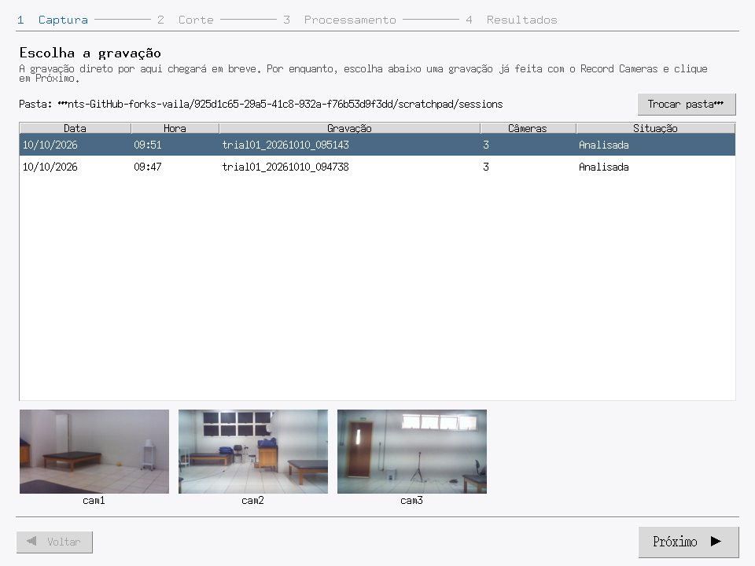
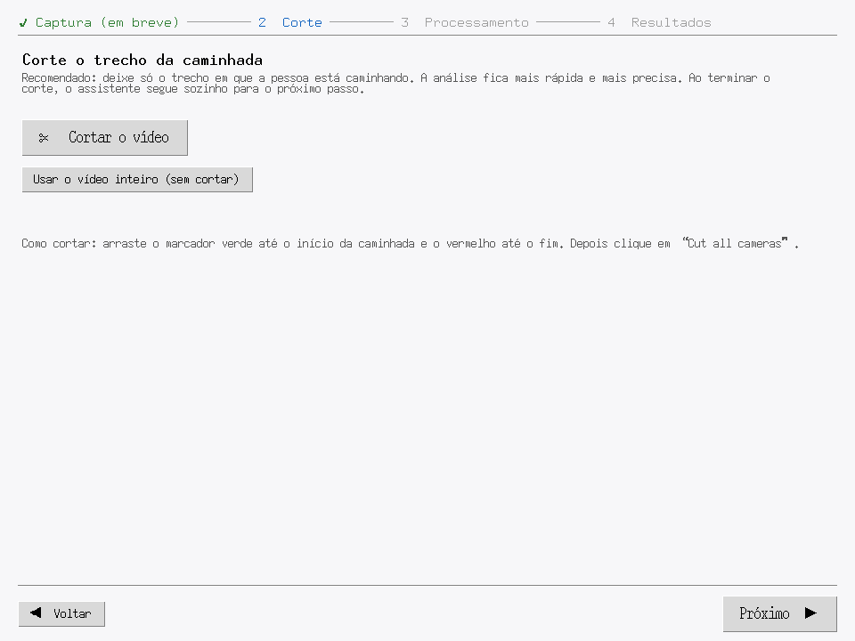
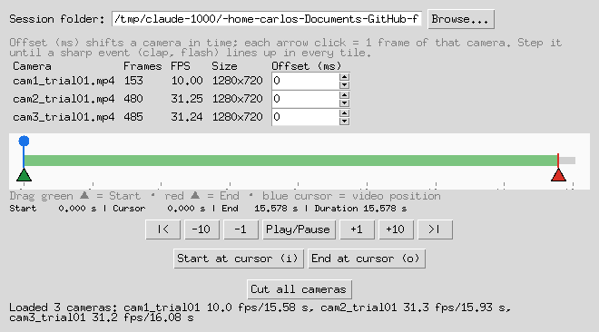
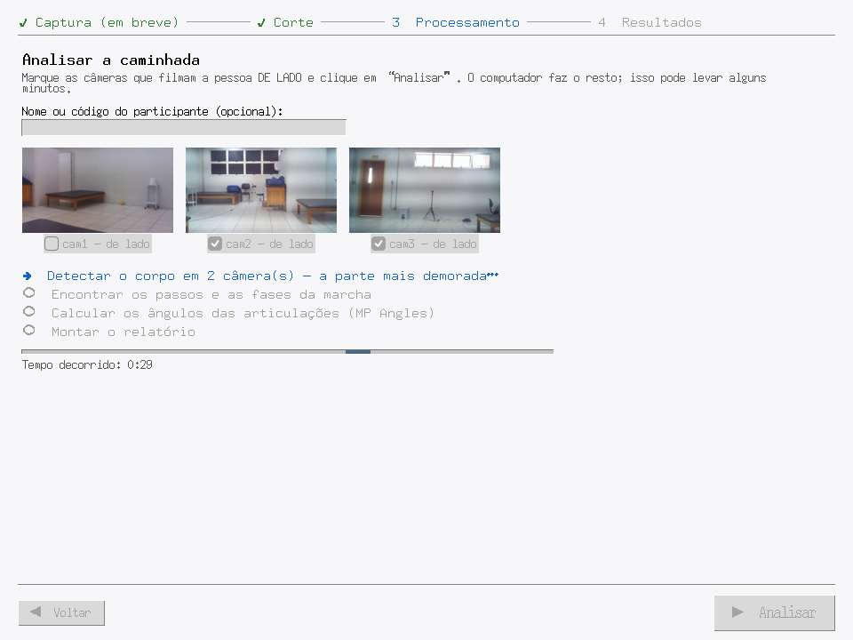
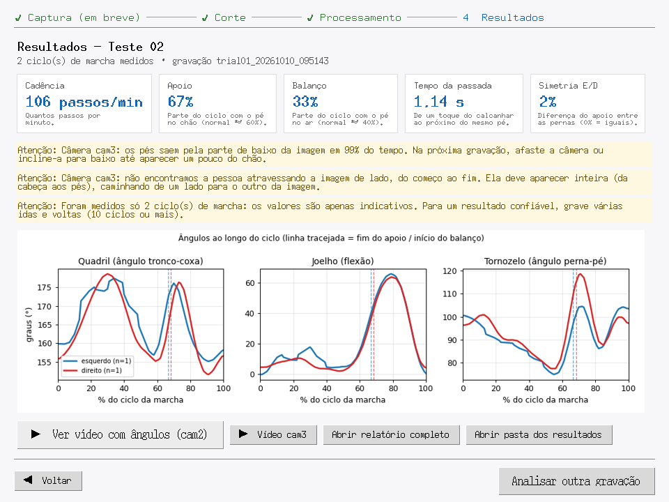
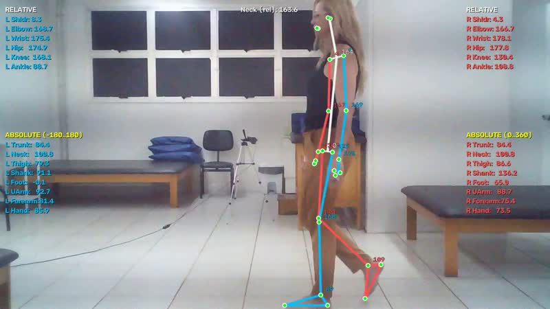
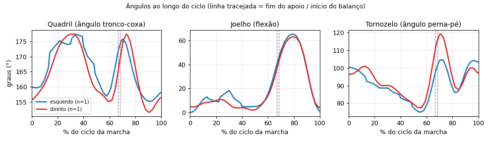

# Marcha Fácil (gait wizard) — test record, 2026-10-12

Test of the first version of **Marcha Fácil** (`vaila/gait_wizard.py`, button
`C_B_r6_c3`). The wizard's screens are in Portuguese. Help page:
[`vaila/help/gait_wizard.md`](../../vaila/help/gait_wizard.md). Design notes:
[`docs/claude-session-notes-archive.md`](../claude-session-notes-archive.md),
entry "TAREFA 1b".

## Setup

- **Data:** real copies (not symlinks, see the note below) of two Record
  Cameras sessions recorded on 2026-10-10 (UNIP, 3 webcams):
  `trial01_20261010_095143` for the end-to-end test and
  `trial01_20261010_094738` for the screens. cam2 and cam3 are the lateral
  (sagittal) views at about 31 fps. cam1 is the frontal/diagonal view at
  about 10 fps.
- **Machine:** laptop with an i7-2670QM CPU (no AVX2, no GPU), Linux, Python
  3.12, MediaPipe on the CPU.
- **Method:** the Tk GUI was driven by a script that clicks through every step
  and calls the real Cut Cameras cut (Start 1.0 s, End 15.0 s), then takes a
  screenshot of each screen. The user's `~/.vaila/vaila_config.toml` was left
  untouched.

## Screens

| Step | Screenshot |
| --- | --- |
| 1 Captura: choose a recording (list with date, time, cameras, status and a preview of each camera) |  |
| 2 Corte: cut, reuse a previous cut, or use the whole video |  |
| 2 (Cut Cameras opened by the wizard with the session already loaded) |  |
| 3 Processamento: running (plain-language checklist, elapsed time) |  |
| 4 Resultados (the big button plays the MP Angles video) |  |
| MP Angles video (frame), opened from the results screen |  |

## End-to-end result (`trial01_20261010_095143`, cut 1–15 s)

| Stage | Time |
| --- | --- |
| Cut, 3 cameras re-encoded with H.264 on the CPU | ~70 s |
| MediaPipe (2 lateral cameras) + gait events + MP Angles + report | ~100 s |
| Same, including the MP Angles videos (full `run_pipeline`, rerun after adding the video) | 2 min 37 s |

**Gait events and phases (cam2):** 2 passes and 2 complete cycles (1 left,
1 right).

| Side | Stride (s) | Stance (s) | Swing (s) | Stance % | Swing % | Cadence (steps/min) | Double support % |
| --- | --- | --- | --- | --- | --- | --- | --- |
| left | 1.118 | 0.745 | 0.373 | 66.6 | 33.4 | 107.3 | 35.5 |
| right | 1.156 | 0.788 | 0.367 | 68.2 | 31.8 | 103.8 | 35.9 |

The wizard showed: cadence 106 steps/min, stance 67 %, swing 33 %, stride
1.14 s, L/R symmetry 2 %. Raw files:
[`gait_cycles.csv`](gait_cycles.csv), [`gait_events.csv`](gait_events.csv),
[`gait_summary.csv`](gait_summary.csv).

**Joint angles (MP Angles) over the gait cycle:**

**MP Angles video** (added the same day, at the user's request, because it is
what catches the attention of therapists and patients): a skeleton and joint
angles drawn over the person for every lateral camera
(`angles/angles_<video>.mp4`, H.264 1280x720, 423 frames for cam2). Rendering
and re-encoding both cameras took **~35 s** on this laptop. The landmarks are
low-passed at 6 Hz before MP Angles, so the drawing is steady (frames with
nobody in view stay empty).

The knee flexion curve has the typical gait shape: a small loading-response
peak (~10–15° at 10–20 % of the cycle) and the swing peak (~65° at ~78 %).
Hip and ankle values are the unsigned angles computed by MP Angles.

**Warnings the wizard showed (correct):**
- cam3: the feet are below the bottom of the image in 99 % of the frames
  with a person, so the camera must be reframed.
- cam3: no walking pass found.
- Only 2 cycles were measured, so the values are only indicative. Aim for 10
  or more cycles.

## Second session (`trial01_20261010_094738`, whole video, screens only)

cam2 found 3 cycles: cadence 126 steps/min, stance 52 %, swing 48 %, stride
1.02 s. On cam3 the feet are cut off in 89 % of the frames.

## Conclusions

- The pipeline works end to end. After choosing the recording, the user only
  marks the walking stretch in Cut Cameras and clicks **Analisar**. The wizard
  moves between the steps by itself.
- The limit is the **recording framing**, not the software. The lateral
  cameras must show the whole body *with the feet and some floor*, and the
  subject should make several crossings.
- The stance % of these few cycles (52–68 %) varies a lot. More cycles per
  session are needed before the numbers can be trusted.

## Notes for whoever runs it again

- Cut Cameras (`syncvid.discover_video_files`) **rejects symlinked videos**,
  so test sessions must be real copies.
- Tk on this laptop has no Xft. The default bold font has no ▶ glyph and no
  font has ⚠. The wizard therefore uses `Helvetica` and writes "Atenção:".
- Unit tests: `uv run pytest tests/test_gait_wizard.py -v` (11 tests).
